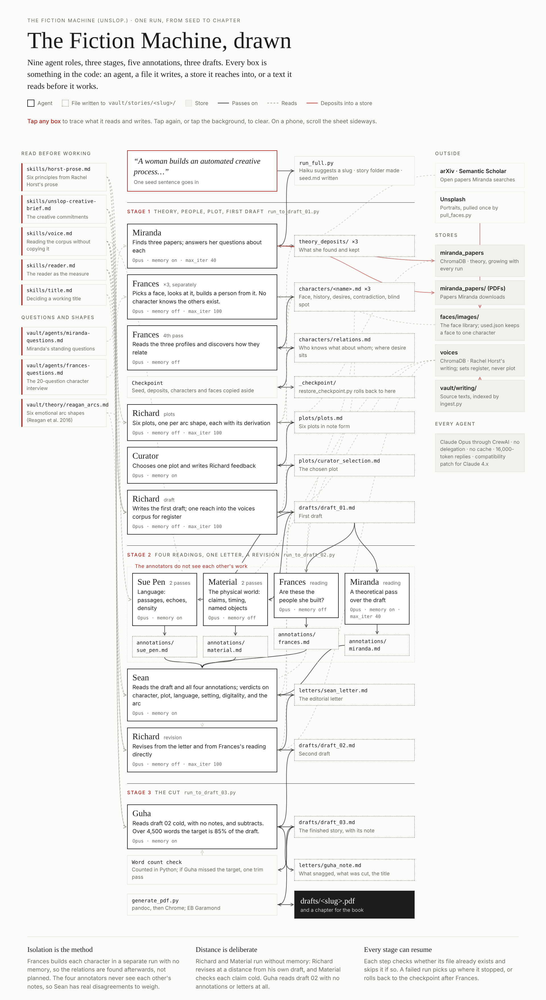

# The Fiction Machine (unslop.)

A multi-agent fiction system designed by Rachel Horst (April 2026). A single seed sentence goes in; a short story comes out, written, annotated, revised and cut by a crew of agents built with [CrewAI](https://www.crewai.com/) on Anthropic's Claude.

**Read the book:** [rshorst.github.io/Fiction-Machine](https://rshorst.github.io/Fiction-Machine/), with a free PDF of every chapter so far.

[](https://rshorst.github.io/Fiction-Machine/diagram.html)

The [interactive diagram](https://rshorst.github.io/Fiction-Machine/diagram.html) shows one run from seed to chapter: every agent, file, store and skill. Tap a box to trace what it reads and writes. How it works, stage by stage, is in [ARCHITECTURE.md](ARCHITECTURE.md). The agents' instructions are in `agents/`, `skills/` and `vault/agents/`. Stories the machine has made are in `vault/stories/` and at [Unslop-stories](https://github.com/rshorst/Unslop-stories).

## What it costs

Every run makes many calls to Claude Opus. A full run takes a while and costs real money on your Anthropic account. Check `outputs/token_log.jsonl` after a run for the exact cost. You can try it on a cheaper model (see Settings), but the stories will be different.

## Setup

You need Python 3.11 and an [Anthropic API key](https://console.anthropic.com/).

```bash
git clone https://github.com/rshorst/Fiction-Machine.git
cd Fiction-Machine
python3.11 -m venv venv
source venv/bin/activate
pip install -r requirements.txt
python ingest.py
```

`ingest.py` builds the local database the agents read from (`chromadb/`). The first time, it downloads a small embedding model (all-MiniLM-L6-v2, about 90 MB) from Hugging Face.

For the PDF at the end you also need [pandoc](https://pandoc.org/installing.html) and Chrome or Chromium. Without them the run still finishes and leaves the story as markdown.

## Run it

```bash
python run_full.py --seed "A woman builds an automated creative process. The process is so complex that each iteration costs more than the last. By the time she understands what it's making, the meter is past anything she can pay." --slug creative_meter --yes
```

The first time, it asks for your Anthropic key (the input is hidden) and offers to save it to a `.env` file in this folder. `.env` is in `.gitignore`, so it is never committed. Or copy `.env.example` to `.env` and fill it in yourself.

Leave out `--slug` and `--yes` and the machine suggests a folder name for the story and asks you to confirm it.

## Where the output lands

Everything for one story goes in `vault/stories/<slug>/`:

| Folder | What's in it |
|---|---|
| `drafts/` | `draft_01.md`, `draft_02.md`, `draft_03.md` (the finished story) and `<slug>.pdf` |
| `characters/` | three character profiles and `relations.md` |
| `plots/` | six plots and the Curator's selection |
| `annotations/` | each annotator's reading of draft 01 |
| `letters/` | Sean's editorial letter and Guha's note |
| `theory_deposits/` | what Miranda found and kept |

A run that stops partway can be resumed: run the same command again and finished stages are skipped.

## Your own material

The machine draws on two collections, rebuilt by `python ingest.py` from whatever is in the vault:

- **`voices`**, from `vault/writing/` (plus the process notes in `vault/inventory/process/`): the writing the agents calibrate their register against. The texts the machine was built with are listed, with links, in `vault/voices/bibliography.md`. Download the ones you want into `vault/writing/` and run `ingest.py` again.
- **`miranda_papers`**, from `vault/theory/papers/`, `vault/theory/deposits/` and `vault/theory/reagan_arcs.md`: theory and research. Miranda also finds open papers on arXiv and Semantic Scholar during each run and adds them here. The papers used so far are listed in `vault/theory/bibliography.md`. They are not included in this repo, since their licences don't allow it.

## Faces and Unsplash

Frances, the agent who builds characters, starts from a photograph of a face. She picks from `faces/images/`, which is empty in this repo. Fill it one of two ways:

1. **From Unsplash:** get a free access key at [unsplash.com/developers](https://unsplash.com/developers), add `UNSPLASH_ACCESS_KEY` to `.env`, then run `python pull_faces.py`. Your use of Unsplash is subject to the [Unsplash API Terms](https://unsplash.com/api-terms) and [API Guidelines](https://help.unsplash.com/en/articles/2511245-unsplash-api-guidelines), including crediting photographers. The script records each photographer for the credits Frances writes.
2. **Your own photos:** put portrait JPGs in `faces/images/`. Use photos you have the right to use.

Without any faces, Frances writes characters without a photograph, which changes how the machine works.

## Settings

All optional, in `.env` (see `.env.example`):

| Setting | What it does |
|---|---|
| `ANTHROPIC_API_KEY` | Required. Runs the agents. |
| `UNSPLASH_ACCESS_KEY` | Only for `pull_faces.py`. |
| `UNSLOP_HOME` | Keep the vault, database, faces and logs in another folder. Defaults to this one. |
| `UNSLOP_MODEL` | The agents' model. Default `anthropic/claude-opus-4-7`. |
| `CHROME_PATH` | Chrome or Chromium for the PDF, if it isn't found automatically. |

## Add your story to the book

The book collects stories made with the machine. Each chapter is the final story and a short note: who ran it, the seed, the date and the model.

```bash
python submit_chapter.py creative_meter --name "Your Name"
```

This turns `vault/stories/creative_meter/drafts/draft_03.md` into `book/chapters/<title>.md` under your name and sends it in as a pull request. It uses the [GitHub CLI](https://cli.github.com/) if you have it signed in; otherwise it tells you how to upload the file on the GitHub website. Only the final story and its note are sent; your drafts, annotations and letters stay with you.

An automatic check makes sure the pull request adds one chapter and nothing else. Rachel Horst reads every chapter before adding it. Once it's added, the website and the PDF rebuild themselves. Chapters are shared under CC BY-NC 4.0.

## Running stages separately

```bash
python new_story.py --seed "..."          # set up a story folder without running anything
python run_to_draft_01.py <slug>          # theory, characters, plots, first draft
python run_to_draft_02.py <slug>          # annotations, editorial letter, revision
python run_to_draft_03.py <slug>          # the editorial cut
python build_book.py                      # build the book website and PDF into site/ (needs pandoc and Chrome)
```

## Licence

The code (Python files and `requirements.txt`) is under the [MIT licence](LICENSE). The writing, including the stories, the agents' instruction files in `skills/` and `vault/agents/`, and the rest of `vault/`, is under [CC BY-NC 4.0](LICENSE-WRITING): free to share and adapt for non-commercial use, with credit.

CrewAI's and ChromaDB's anonymous usage telemetry is switched off by default (see `.env.example`).

## Credits

Designed by Rachel Horst. Built with CrewAI, Anthropic's Claude, ChromaDB and sentence-transformers. Story arc shapes from Reagan et al. (2016), "The emotional arcs of stories are dominated by six basic shapes," *EPJ Data Science* 5:31.
